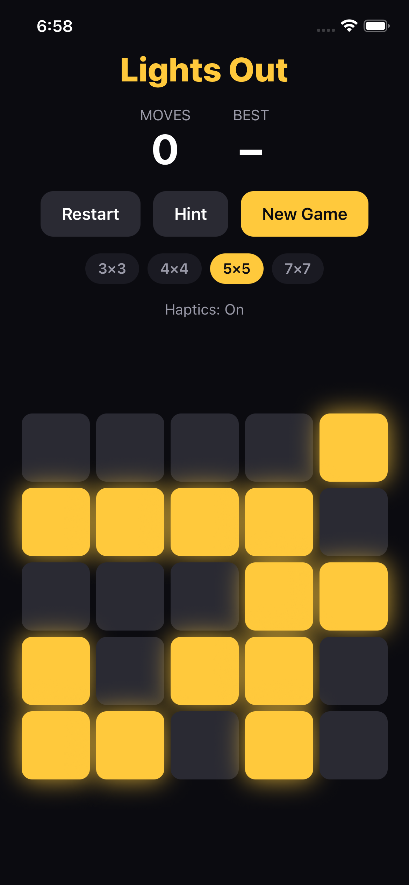
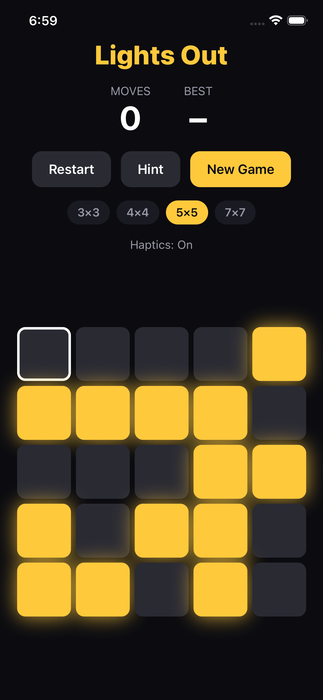
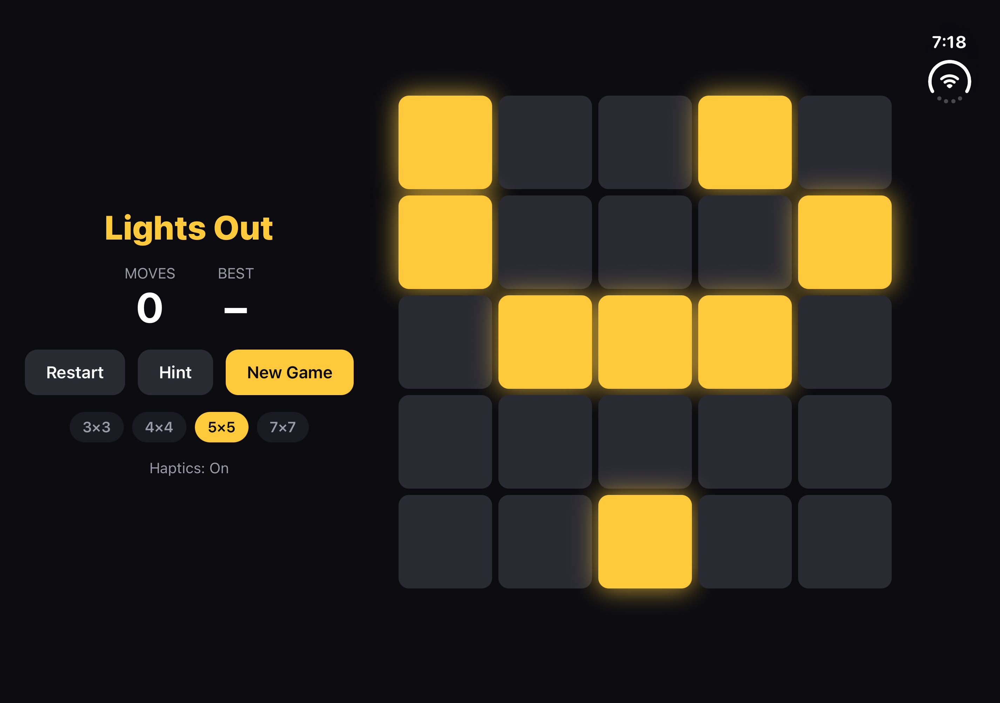
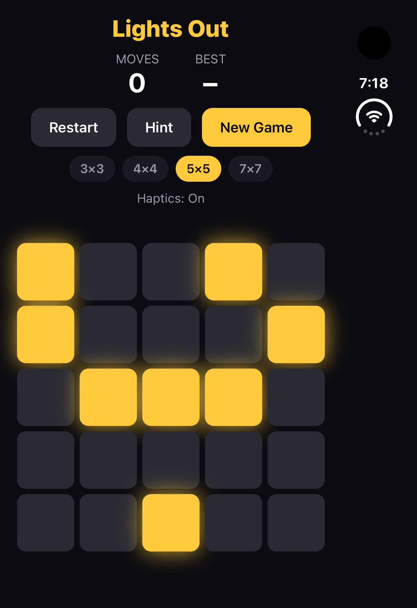

# Lights Out

A polished, offline Lights Out puzzle for iOS and Android, built with Expo and React Native.

A grid of tiles starts with some lights on. Tapping a tile toggles it and its up, down, left and right neighbors. Turn every light off to win, in as few moves as you can.

<p>
  
  
</p>

## Adaptive layout

The layout adapts to the window. On a phone in portrait the controls sit above the board. On a wide window, such as the open dual-screen iPhone Duo simulator or a rotated phone, the controls move to a left column and the board grows to fill the screen. On short screens the header tightens up.

<p>
  
  
</p>

*iPhone Duo simulator, open (left) and closed (right). The closed screen reserves a strip on one side, so the content sits off-center on purpose.*

## Features

- **Always solvable.** Every puzzle is generated by tapping a solved board, so a solution is guaranteed.
- **Four grid sizes:** 3×3, 4×4, 5×5 and 7×7. Your last choice is remembered.
- **Best scores** are kept per grid size and persist across launches.
- **Hints.** A Gaussian-elimination solver over GF(2) finds a shortest solution and highlights one tile to tap. A win that used a hint doesn't set a best score.
- **Smooth animation:** tile color blends, a glow on lit tiles, a ripple from the tapped tile, and an animated win screen.
- **Haptic feedback**, which can be turned off from the header.
- **Adaptive layout** for phones, rotated screens and dual-screen devices.
- **Fully offline.** No accounts, no network.

## How to play

1. Tap a tile to flip it and its orthogonal neighbors. Edge and corner tiles have fewer neighbors.
2. Turn every light off to win. Your score is the number of moves, and lower is better.
3. Use the buttons above the board:
   - **Restart** replays the same puzzle from the start.
   - **Hint** highlights a tile on a shortest solution.
   - **New Game** generates a new puzzle.
   - The **3×3 / 4×4 / 5×5 / 7×7** chips switch the grid size and start a new game.
   - **Haptics** turns vibration feedback on or off.

### Solving by hand

Work from the top row down. For every lit tile in rows 1 to 4, tap the tile directly below it. That leaves lights only in the bottom row. On a 5×5 board, look up that bottom row (1 is the leftmost tile) and tap the listed tiles in the top row, then repeat the first step:

| Bottom row lit | Tap in the top row |
| --- | --- |
| 1, 5 | 4, 5 |
| 2, 4 | 3, 4, 5 |
| 3, 4, 5 | 1, 3, 4, 5 |
| 1, 2, 3 | 1, 4, 5 |
| 2, 3, 5 | 2, 4, 5 |
| 1, 3, 4 | 2, 3, 4, 5 |
| 1, 2, 4, 5 | 1, 2, 3, 4, 5 |

## Getting started

Requires Node.js 20 or later and the [Expo Go](https://expo.dev/go) app, or an iOS simulator or Android emulator.

```bash
npm install
npx expo start
```

Then press `i` for the iOS simulator, `a` for the Android emulator, or scan the QR code with Expo Go.

## Scripts

| Command | What it does |
| --- | --- |
| `npm start` | Start the Expo dev server |
| `npm test` | Run the Jest tests |
| `npm run typecheck` | Type-check with `tsc --noEmit` |
| `npm run lint` | Lint with `expo lint` |

## Project structure

```
src/
  app/          Expo Router entry: the single game screen and root layout
  components/   Board, Tile, Header, WinModal
  game/         Pure logic: toggle, generate, solver, reducer, types (unit tested)
  hooks/        useGame (game, hints and best scores), useSettings
  lib/          Haptics wrapper
  storage/      AsyncStorage persistence for best scores and settings
```

The game rules live in pure functions under `src/game`, so they're easy to test without any UI. See [PLAN.md](PLAN.md) for how the app was built and what's planned next, and [MVP.md](MVP.md) for the original build guide.

## Tech stack

Expo SDK 58 (managed workflow, Expo Router), React Native, TypeScript, React Native Reanimated, AsyncStorage and Expo Haptics. State is plain React hooks with `useReducer`.
